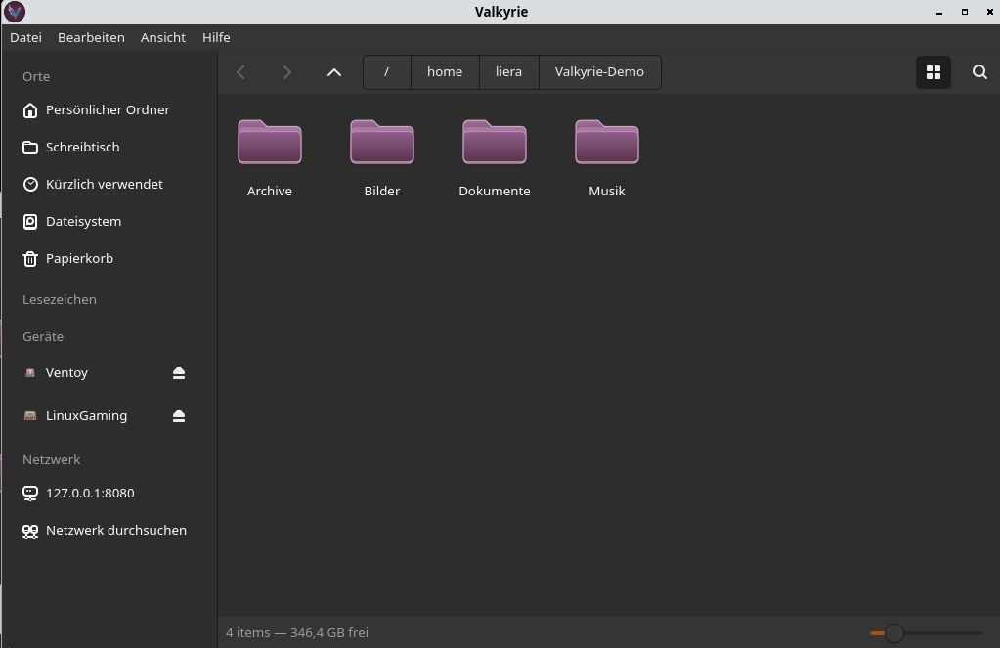
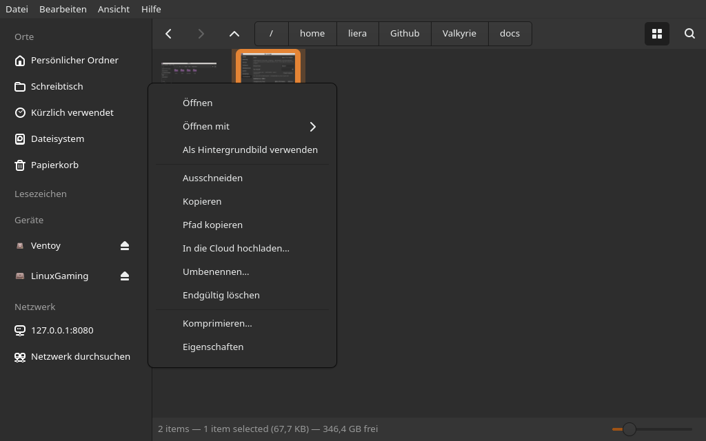
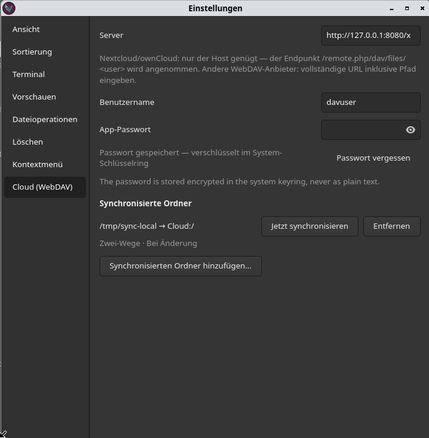

# Valkyrie

The LieraOS file manager — a GTK4 file browser written in Rust.

Valkyrie aims at the classic file-manager feature set and goes beyond
it in places: tabs that drag between windows, a split view, an embedded
terminal, an integrity-verified parallel copy engine, and two-way
WebDAV folder sync — all without a webview or a framework underneath,
just GTK4, GIO and Rust.

> **Status:** stable and in daily use. Two areas are still pending
> real-world verification — see `TODO.md`: WebDAV sync against a real
> Nextcloud/ownCloud server (verified only against a local test server
> so far) and a terminal-panel input edge case.

## Screenshots

| Main window | Context menu | Preferences |
|---|---|---|
|  |  |  |

## Features

### Browsing

- Tabs (Ctrl+T / Ctrl+W), close button and middle-click close,
  detachable between windows — dragging a tab outside every window
  opens a new one; the tab bar auto-hides with a single tab
- Icon grid and details list (Name/Size/Type/Modified, clickable
  column headers); natural filename sort (file_2 < file_10)
- Split view (F3): two independent panes per tab, each with its own
  history and breadcrumb; "Copy/Move to Other Pane" in row menus
- Breadcrumb pathbar, Ctrl+L location entry, back/forward/up,
  mouse side buttons 8/9
- Recursive search (Ctrl+F): case-insensitive worker-thread match,
  results stream into the normal view, every keystroke cancels
  the previous run; stays on the starting filesystem, never follows
  symlinked directories
- Zoom slider in the status bar; icon size remembered per directory
  in GVFS metadata
- Directory monitoring survives delete-and-recreate cycles (parent-
  directory watch — the inotify/inode-bound monitor would go silent
  otherwise)

### File operations

- Copy/move/delete on a worker thread with a cancellable progress
  window (bytes, rate, ETA, current entry); directory copies recurse,
  deletes are post-order
- Local copies try a FICLONE reflink first (instant on btrfs/xfs),
  fall back to a streamed pipeline; metadata re-applied via
  copy_attributes on both paths
- Optional integrity verification: BLAKE3 hash of the source inline
  while copying, destination re-hashed — mismatches collected into
  one report
- Optional parallel copy pool: N workers pull file payloads from a
  shared FIFO while the tree walk stays sequential (core count
  capped, HDD warning included)
- USB write safety: sync_data() pacing paces writes to device speed,
  syncfs() per job — "done" means physically on the medium
- Name collisions ask instead of silently duplicating: conflict
  dialog with both files' metadata, Replace/Merge, Rename, Skip,
  Cancel, "apply to all"
- Undo (Ctrl+Z) for copy, move and trash; per-window journal;
  permanent delete is not undoable
- Permanent delete (Shift+Delete) with optional secure-delete mode:
  1–7 random-data passes, one-time honesty warning on SSD/CoW media

### Desktop integration

- Places/devices/network sidebar: bookmarks (per context menu),
  volumes with mount/unmount/eject, cloud and trash rows
- Trash: restore via trash::orig-path, single-item and full-empty
  delete with confirmation
- Open With submenu from registered handlers; "Other Application…"
  chooser with optional set-as-default
- "Open as Administrator" via gvfsd-admin + pkexec polkit prompt;
  elevated windows get a red frame
- "Open in Terminal" (detected emulator) and an embedded VTE
  terminal panel (F4) that follows the active tab's directory
- System clipboard interop both ways (x-special/gnome-copied-files +
  text/uri-list); cut items ghost out, staged copies show a marker
- Drag & drop: rows carry a gdk::FileList payload; drop = move,
  Ctrl+drop = copy; onto folder rows, background and tab labels
- Archives: "Extract Here" / "Compress…" (zip, tar.gz, 7z) via the
  system tools; browsing inside archives delegates to file-roller
- "Set as Background" on image files (desktop background GSettings)
- Rubber-band multi-selection in icon and list views; context-menu
  actions apply to the whole selection when the clicked row is part
  of it

### Cloud sync (WebDAV)

- Generic WebDAV — Nextcloud, ownCloud and any DAV provider through
  gvfs-dav; a bare host resolves to the Nextcloud endpoint
  convention, a full URL is used verbatim
- App password in the system keyring (libsecret), never in
  GSettings or process argv
- "Upload to Cloud…" on files/folders with a remote folder picker,
  through the regular copy engine (progress, cancel, conflicts)
- Synced folders: local directory paired with a remote path —
  upload-only or two-way mirror, manual / interval / live-watch
  schedule; a per-pair journal distinguishes "deleted" from "newly
  appeared" and preserves conflict losers as "(conflict)" copies

### Customization & dialogs

- Preferences (Ctrl+,) as a category sidebar: View, Sorting,
  Terminal, Thumbnails, Delete, File operations, Context menu,
  Nextcloud — every context-menu entry except Open/Properties can
  be hidden individually
- Batch rename on multi-selections: find/replace + {name}/{ext}/{n}
  pattern with live preview
- Editable properties: rename from the Name entry, real Owner/Group
  dropdowns (pkexec elevation when needed), rwx matrix with live
  octal entry; directory contents counted asynchronously
- Optional POSIX permissions on create (New Folder/Document
  expander, preset to umask defaults)
- Thumbnails for images, PDF (poppler) and video (ffmpegthumbnailer)
  with a per-type policy (Always / up to N MB / Never); shares the
  freedesktop cache with every other application
- German and English UI (gettext, English fallback); documentation
  in both languages (README_de.md, TODO_de.md)

## Build

```bash
cargo build --release

# gettext catalogs (needed for the .deb assets)
for lang in de en; do
    mkdir -p target/locale/$lang/LC_MESSAGES
    msgfmt po/$lang.po -o target/locale/$lang/LC_MESSAGES/valkyrie.mo
done
```

## Local install (no package)

```bash
cp target/release/valkyrie ~/.local/bin/

# app icon (hicolor) + desktop file + GSettings schema as usual
mkdir -p ~/.local/share/icons/hicolor/512x512/apps
cp icon/icon.png ~/.local/share/icons/hicolor/512x512/apps/valkyrie.png

# Valkyrie icon theme — picked up automatically at startup
mkdir -p ~/.local/share/icons
cp -r Theme/Valkyrie ~/.local/share/icons/
```

The icon theme is activated via `gtk-icon-theme-name` for Valkyrie's
windows only — other applications keep their configured theme.

## Package

```bash
cargo install cargo-deb   # once
packaging/build-deb.sh
# produces target/debian/valkyrie_<version>-1_amd64.deb
```

`build-deb.sh` builds the release binary, compiles the gettext
catalogs into `target/locale/` (cargo-deb copies files verbatim) and
runs `cargo deb`. The package ships the binary, the desktop entry,
the GSettings schema, the hicolor app icon, the Valkyrie icon theme
and the `de`/`en` catalogs — schema compilation and desktop/icon
caches run through dpkg file triggers on install.

Runtime dependencies beyond GTK4/GLib: `gvfs`, `gvfs-backends`,
`gvfs-daemons` (trash, recent, network, admin locations, WebDAV for
the cloud integration via `gvfsd-dav`) and `libsecret-common` (keyring
storage for the app password). Optional tools: `7z`/`tar` (archives),
`pdftoppm` (PDF thumbnails), `ffmpegthumbnailer` (video thumbnails),
`secret-tool` (keyring access), a VTE terminal for the panel.

To register Valkyrie as the default file manager system-wide, set
`inode/directory=org.lieraos.valkyrie.desktop` in the distribution's
`/etc/xdg/mimeapps.list` (or per user in `~/.config/mimeapps.list`).

## Source layout

Single binary crate, one responsibility per module — every file
carries a header comment describing its job:

- `main.rs`, `app.rs`, `i18n.rs`, `settings.rs` — entry point,
  GtkApplication, gettext, GSettings access
- `window/` + `window.rs`, `window_actions.rs`, `menubar.rs`,
  `menu_widgets.rs` — window, win.* actions, menus
- `browser_tab/` + `browser_tab.rs`, `pane_view.rs`, `navigation.rs`,
  `pathbar.rs` — tabs, split view, history
- `file_view.rs`, `file_view/`, `view_model.rs`, `view_widgets.rs`,
  `view_grid.rs`, `file_object.rs`, `rubberband.rs` — the file views
  and their model pipeline
- `operations.rs`, `tree_ops.rs`, `tree_ops/`, `progress.rs`,
  `progress/`, `fast_copy.rs`, `copy_pool.rs`, `conflict.rs`,
  `undo.rs`, `secure_wipe.rs`, `trash_actions.rs` — file operations
  and the copy engine
- `sidebar.rs`, `sidebar/`, `mount_ops.rs` — places/devices/network
- `terminal.rs`, `terminal_panel.rs` — external + embedded terminal
- `search.rs`, `thumbnails.rs`, `dir_watch.rs`, `dnd.rs`,
  `archive.rs`, `archive_ui.rs`, `zoom.rs`, `open_with.rs` — view
  services
- `properties.rs`, `properties_perms.rs`, `mode_editor.rs`,
  `rename.rs`, `batch_rename.rs`, `create_entry.rs`,
  `settings_dialog.rs`, `context_menu.rs`, `context_menu/` — dialogs
- `nextcloud.rs`, `nextcloud/` — WebDAV upload + sync engine
  (plan/exec/state/monitor/folders_ui)
- `secrets.rs` — system keyring wrapper

Design notes: location identity is the `gio::File` URI; file
operations run on worker threads with progress over an mpsc channel;
enumeration is async via `gtk::DirectoryList`.

## License

GPL-3.0-or-later — Copyright (C) 2026 Jörg Schröder, LieraOS Project.
