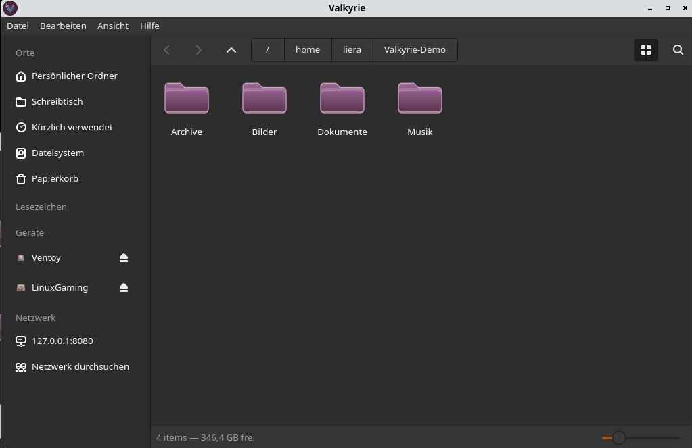
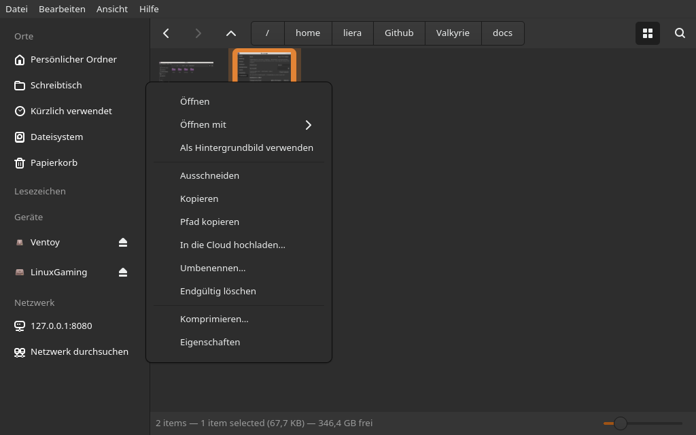
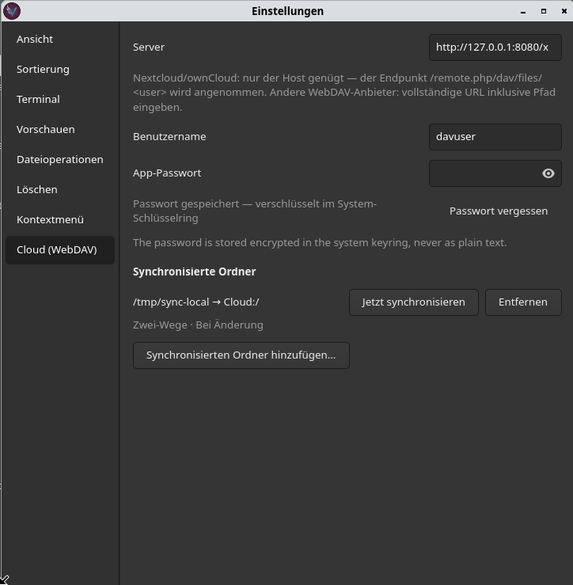

#  Valkyrie

Der LieraOS-Dateimanager — ein GTK4-Dateibrowser in Rust.

Valkyrie zielt auf den klassischen Dateimanager-Funktionsumfang und
geht an einigen Stellen darüber hinaus: Tabs, die zwischen Fenstern
gezogen werden können, eine geteilte Ansicht, ein eingebettetes
Terminal, eine parallelisierte Copy-Engine mit Integritätsprüfung und
Zwei-Wege-WebDAV-Ordnersync — alles ohne Webview oder Framework
darunter, nur GTK4, GIO und Rust.

> **Status:** stabil und im täglichen Einsatz. Ein Bereich wartet
> noch auf Verifikation im Realbetrieb — siehe `TODO_de.md`: WebDAV-
> Sync gegen einen echten Nextcloud/ownCloud-Server (bisher nur gegen
> einen lokalen Testserver verifiziert).

## Screenshots

| Hauptfenster | Kontextmenü | Einstellungen |
|---|---|---|
|  |  |  |

## Funktionen

### Browsen

- Tabs (Strg+T / Strg+W), Schließen-Button und Mittelklick-Schließen,
  zwischen Fenstern ablösbar — ein Tab, der aus jedem Fenster
  herausgezogen wird, öffnet ein neues; die Tableiste blendet sich
  bei nur einem Tab automatisch aus
- Drei Ansichtsmodi — Icon-Raster, Detail-Liste und Kompaktliste —
  umschaltbar über die verknüpften Toolbar-Buttons, das Ansicht-Menü
  oder Strg+1/2/3; die Detail-Liste hat in der Breite verstellbare
  Spalten (Name/Größe/Typ/Geändert); ein abgeschnittener Dateiname
  klappt beim Überfahren mit der Maus nach unten auf, ohne das
  Layout zu verschieben; natürliche Dateinamen-Sortierung
  (file_2 < file_10)
- Geteilte Ansicht (F3): zwei unabhängige Panes pro Tab, jeweils mit
  eigener Historie und Breadcrumb; „In andere Ansicht kopieren/
  verschieben" in den Zeilenmenüs
- Breadcrumb-Pfadleiste, Strg+L-Ortseingabe, Zurück/Vorwärts/Hoch,
  Maus-Seitentasten 8/9
- Rekursive Suche (Strg+F): Groß-/Kleinschreibung-insensitiv im
  Worker-Thread, Treffer strömen in die normale Ansicht, jeder
  Tastendruck bricht den vorherigen Lauf ab; bleibt auf dem
  Start-Dateisystem, folgt nie verlinkten Verzeichnissen
- Zoom-Regler in der Statusleiste; Icon-Größe wird pro Verzeichnis
  in GVFS-Metadaten gespeichert
- Live-Verzeichnisansicht: neue Dateien erscheinen sofort (eigener
  debounced GFileMonitor — GtkDirectoryLists interner Monitor
  verwirft ins-Verzeichnis-verschobene Events wie Browser-Download-
  Renames), während Schreib-Churn durch wachsende Downloads erst nach
  einer Ruhepause oder beim Schließen aktualisiert; Löschen-und-
  Neuanlegen überlebt eine Parent-Verzeichnis-Watch

### Dateioperationen

- Kopieren/Verschieben/Löschen im Worker-Thread mit abbrechbarem
  Fortschrittsfenster (Bytes, Rate, ETA, aktueller Eintrag);
  Verzeichniskopien rekursieren, Löschungen laufen post-order
- Lokale Kopien versuchen zuerst einen FICLONE-Reflink (sofort auf
  btrfs/xfs), fallen auf eine gestreamte Pipeline zurück; Metadaten
  werden auf beiden Pfaden per copy_attributes neu angewandt
- Optionale Integritätsprüfung: BLAKE3-Hash der Quelle inline beim
  Kopieren; Ziele werden auf einer Hintergrund-Verify-Lane parallel
  zum Kopiervorgang erneut gehasht — der Balken bleibt in Bewegung,
  „fertig" wartet trotzdem auf den letzten Hash; Abweichungen werden
  in einem Bericht gesammelt
- Optionaler paralleler Copy-Pool: N Worker ziehen Datei-Payloads aus
  einer gemeinsamen FIFO, während der Tree-Walk sequenziell bleibt
  (auf CPU-Kerne gedeckelt, HDD-Hinweis inklusive)
- USB-Schreibsicherheit: sync_data()-Pacing steuert Schreibzugriffe
  auf Gerätegeschwindigkeit, syncfs() pro Job — „fertig" heißt
  physisch auf dem Medium
- Namenskollisionen fragen nach statt still zu duplizieren:
  Konfliktdialog mit den Metadaten beider Dateien, Ersetzen/
  Zusammenführen, Umbenennen, Überspringen, Abbrechen, „für alle
  übernehmen"
- Rückgängig (Strg+Z) für Kopieren, Verschieben und Papierkorb;
  Journal pro Fenster; endgültiges Löschen ist nicht rückgängig
  machbar
- Endgültiges Löschen (Umschalt+Entf) mit optionalem Secure-Delete-
  Modus: 1–7 Durchgänge Zufallsdaten, einmaliger ehrlicher Hinweis
  bei SSD/CoW-Medien

### Desktop-Integration

- Orte/Geräte/Netzwerk-Sidebar: Lesezeichen (per Kontextmenü),
  Laufwerke mit Einhängen/Aushängen/Auswerfen, Cloud- und
  Papierkorb-Zeilen
- Papierkorb: Wiederherstellen via trash::orig-path, Einzel- und
  Komplett-Leeren mit Bestätigung
- „Öffnen mit"-Untermenü aus registrierten Handlern;
  „Andere Anwendung…"-Auswahl mit optionalem Als-Standard-setzen
- „Als Administrator öffnen" via gvfsd-admin + pkexec-Polkit-
  Abfrage; erhöhte Fenster bekommen einen roten Rahmen
- „Im Terminal öffnen" (erkanntes Emulator-Programm) und ein
  eingebettetes VTE-Terminal-Panel (F4), das dem Ordner des aktiven
  Tabs folgt — das injizierte `cd` wartet auf einen sauberen Prompt
  und landet nie mitten in halb getippter Eingabe oder einem
  laufenden Vordergrund-Programm
- System-Zwischenablage in beide Richtungen
  (x-special/gnome-copied-files + text/uri-list); ausgeschnittene
  Einträge werden geghostet, bereitgestellte Kopien zeigen eine
  Markierung
- Drag & Drop: Zeilen tragen eine gdk::FileList-Payload;
  Drop = verschieben, Strg+Drop = kopieren; auf Ordnerzeilen,
  Hintergrund und Tab-Titel
- Archive: „Hier entpacken" / „Komprimieren…" (zip, tar.gz, 7z) über
  die Systemwerkzeuge; das Browsen in Archiven delegiert an
  file-roller
- „Als Hintergrundbild setzen" auf Bilddateien (Desktop-
  Hintergrund-GSettings)
- Gummiband-Mehrfachauswahl in Icon- und Listenansicht;
  Kontextmenü-Aktionen gelten für die ganze Auswahl, wenn die
  angeklickte Zeile Teil davon ist

### Cloud-Sync (WebDAV)

- Generisches WebDAV — Nextcloud, ownCloud und jeder DAV-Anbieter
  über gvfs-dav; ein nackter Host wird auf die Nextcloud-Endpunkt-
  Konvention aufgelöst, eine volle URL wird wörtlich verwendet
- App-Passwort im System-Keyring (libsecret), niemals in GSettings
  oder Prozess-argv
- „In die Cloud hochladen…" auf Dateien/Ordnern mit Remote-Ordner-
  Auswahl, über die reguläre Copy-Engine (Fortschritt, Abbruch,
  Konflikte)
- Synchronisierte Ordner: lokales Verzeichnis mit einem Remote-Pfad
  gepaart — nur-hochladen oder Zwei-Wege-Spiegelung, manuell /
  Intervall / Live-Watch; ein Journal pro Paar unterscheidet
  „gelöscht" von „neu erschienen" und bewahrt Konflikt-Verlierer
  als „(Konflikt)"-Kopien auf

### Anpassung & Dialoge

- Einstellungen (Strg+,) als Kategorie-Sidebar: Ansicht,
  Sortierung, Terminal, Thumbnails, Löschen, Dateioperationen,
  Kontextmenü, Nextcloud — jeder Kontextmenü-Eintrag außer
  Öffnen/Eigenschaften ist einzeln ausblendbar
- Stapel-Umbenennen bei Mehrfachauswahl: Suchen/Ersetzen +
  {name}/{ext}/{n}-Muster mit Live-Vorschau
- Editierbare Eigenschaften: Umbenennen direkt aus dem Namensfeld,
  echte Eigentümer/Gruppen-Dropdowns (pkexec-Erhöhung falls nötig),
  rwx-Matrix mit live-Oktal-Eingabe; Verzeichnisinhalte werden
  asynchron gezählt
- Optionale POSIX-Berechtigungen beim Anlegen (Neuer-Ordner/Neues-
  Dokument-Expander, auf umask-Defaults voreingestellt)
- Thumbnails für Bilder, PDF (poppler) und Video (ffmpegthumbnailer)
  mit Per-Typ-Richtlinie (Immer / bis N MB / Nie); teilt den
  freedesktop-Cache mit jeder anderen Anwendung
- Deutsche und englische Oberfläche (gettext, englischer Fallback);
  Dokumentation zweisprachig (README.md, TODO.md)

## Build

```bash
cargo build --release

# gettext-Kataloge (für die .deb-Assets nötig)
for lang in de en; do
    mkdir -p target/locale/$lang/LC_MESSAGES
    msgfmt po/$lang.po -o target/locale/$lang/LC_MESSAGES/valkyrie.mo
done
```

## Lokale Installation (ohne Paket)

```bash
cp target/release/valkyrie ~/.local/bin/

# App-Icon (hicolor) + Desktop-Datei + GSettings-Schema wie üblich
mkdir -p ~/.local/share/icons/hicolor/512x512/apps
cp icon/icon.png ~/.local/share/icons/hicolor/512x512/apps/valkyrie.png

# Valkyrie-Icon-Theme — wird beim Start automatisch erkannt
mkdir -p ~/.local/share/icons
cp -r Theme/Valkyrie ~/.local/share/icons/
```

Das Icon-Theme wird über `gtk-icon-theme-name` nur für Valkyries
Fenster aktiviert — andere Anwendungen behalten ihr konfiguriertes
Theme.

## Paket

```bash
cargo install cargo-deb   # einmalig
packaging/build-deb.sh
# erzeugt target/debian/valkyrie_<version>-1_amd64.deb
```

`build-deb.sh` baut das Release-Binary, kompiliert die gettext-
Kataloge nach `target/locale/` (cargo-deb kopiert Dateien wörtlich)
und führt `cargo deb` aus. Das Paket liefert Binary, Desktop-Eintrag,
GSettings-Schema, hicolor-App-Icon, das Valkyrie-Icon-Theme und die
`de`/`en`-Kataloge — Schema-Kompilierung und Desktop/Icon-Caches
laufen beim Installieren über dpkg-File-Trigger.

Laufzeit-Abhängigkeiten über GTK4/GLib hinaus: `gvfs`,
`gvfs-backends`, `gvfs-daemons` (Papierkorb, Recent, Netzwerk,
Admin-Orte, WebDAV für die Cloud-Integration via `gvfsd-dav`) und
`libsecret-common` (Keyring-Speicher für das App-Passwort). Optionale
Werkzeuge: `7z`/`tar` (Archive), `pdftoppm` (PDF-Thumbnails),
`ffmpegthumbnailer` (Video-Thumbnails), `secret-tool` (Keyring-
Zugriff), ein VTE-Terminal für das Panel.

Um Valkyrie systemweit als Standard-Dateimanager zu registrieren,
`inode/directory=org.lieraos.valkyrie.desktop` in der
`/etc/xdg/mimeapps.list` der Distribution setzen (oder pro Nutzer in
`~/.config/mimeapps.list`).

## Quellcode-Aufbau

Einzelnes Binary-Crate, eine Verantwortung pro Modul — jede Datei
trägt einen Kopf-Kommentar, der ihre Aufgabe beschreibt:

- `main.rs`, `app.rs`, `i18n.rs`, `settings.rs` — Einstiegspunkt,
  GtkApplication, gettext, GSettings-Zugriff
- `window/` + `window.rs`, `window_actions.rs`, `menubar.rs`,
  `menu_widgets.rs` — Fenster, win.*-Actions, Menüs
- `browser_tab/` + `browser_tab.rs`, `pane_view.rs`, `navigation.rs`,
  `pathbar.rs` — Tabs, geteilte Ansicht, Historie
- `file_view.rs`, `file_view/`, `view_model.rs`, `view_widgets.rs`,
  `view_grid.rs`, `file_object.rs`, `rubberband.rs` — die Datei-
  ansichten und ihre Modell-Pipeline
- `operations.rs`, `tree_ops.rs`, `tree_ops/`, `progress.rs`,
  `progress/`, `fast_copy.rs`, `copy_pool.rs`, `conflict.rs`,
  `undo.rs`, `secure_wipe.rs`, `trash_actions.rs` — Dateioperationen
  und die Copy-Engine
- `sidebar.rs`, `sidebar/`, `mount_ops.rs` — Orte/Geräte/Netzwerk
- `terminal.rs`, `terminal_panel.rs` — externes + eingebettetes
  Terminal
- `search.rs`, `thumbnails.rs`, `dir_watch.rs`, `dnd.rs`,
  `archive.rs`, `archive_ui.rs`, `zoom.rs`, `open_with.rs` —
  Ansichts-Dienste
- `properties.rs`, `properties_perms.rs`, `mode_editor.rs`,
  `rename.rs`, `batch_rename.rs`, `create_entry.rs`,
  `settings_dialog.rs`, `context_menu.rs`, `context_menu/` — Dialoge
- `nextcloud.rs`, `nextcloud/` — WebDAV-Upload + Sync-Engine
  (plan/exec/state/monitor/folders_ui)
- `secrets.rs` — System-Keyring-Wrapper

Design-Hinweise: Orts-Identität ist die `gio::File`-URI; Datei-
operationen laufen auf Worker-Threads mit Fortschritt über einen
mpsc-Channel; die Enumeration läuft asynchron via
`gtk::DirectoryList`.

Dateinamen-Effekte (`fxlabel.rs`, `fxcfg.rs`): Die Namens-
Beschriftungen in Listen-, Raster- und Kompaktansicht sind
`FxLabel`-Widgets (GtkLabel ist final, daher ein echtes
Pango/Cairo-Widget). Sie lesen
`~/.config/ragnar-settings/font-effects.ini` [names] live —
optional Helligkeits-Pulsieren oder eine über die Glyphen
laufende Farbwelle, einstellbar in Ragnar Settings →
Erscheinungsbild → Schriften. Deaktiviert = normales Rendern
ohne Mehrkosten; die Hover-Erweiterung abgeschnittener Namen
funktioniert weiter.

## Lizenz

GPL-3.0-or-later — Copyright (C) 2026 Jörg Schröder, LieraOS Project.
